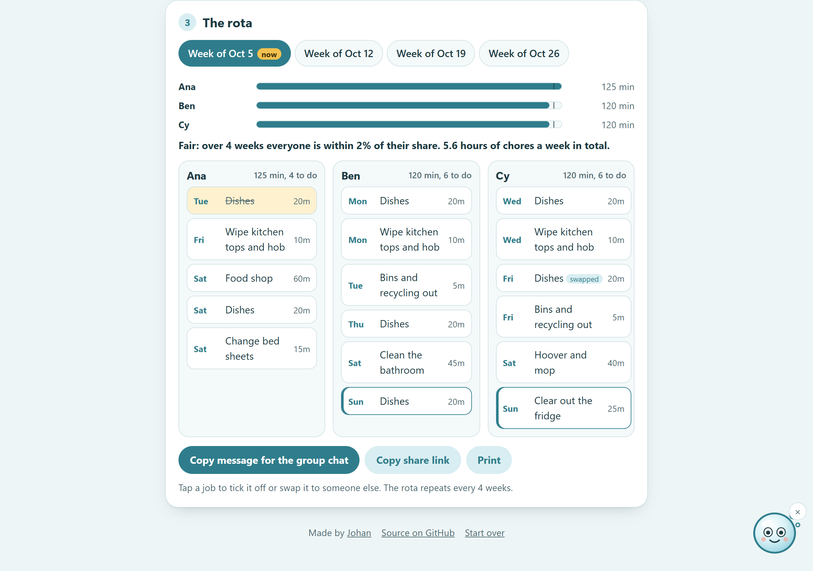

# ChoreShare

A fair chore rota for a shared house or a family. Add who lives there and what needs doing, and ChoreShare splits the chores by time, rotates the worst ones and writes the message for the group chat. Suds the soap bubble helps you set it up.

**Live:** https://choreshare.johanthegoat.xyz



## The problem

Chores are the most common thing people who live together fight about:

- In a [Nationwide poll of 2,000+ people who had lived in shared housing](https://www.nationwide.co.uk/media/news/house-share-from-hell-brits-reveal-lack-of-sharing-leads-to-housemate-squabbles), 60% had argued over who is responsible for cleaning.
- A [Taskrabbit / Wakefield Research survey of 1,000 US adults](https://www.taskrabbit.com/press/release/taskrabbit-survey-reveals-americas-dirty-secrets-about-cleaning) found 78% have had a fight about household chores.

Most rotas count jobs, not time. "One chore each" puts five minutes of bins against forty-five minutes of bathroom, and the same person ends up with the bathroom every week.

## How it works

1. **Who lives here?** Add names. Anyone can be on a full, half or quarter share (kids, someone away a lot).
2. **What needs doing?** Each chore has minutes and how often: every day, 3 times a week, twice a week, weekly, every 2 weeks or every 4 weeks. "Add the usual ones" fills in a starter list. Two grids mark chores someone hates and chores someone can't do at all.
3. **The rota.** Four weeks, starting this Monday. Each person gets a card with their jobs by day, and a bar shows their minutes against a fair share. Tap a job to tick it off or swap it to someone else. Copy the week as a group chat message, copy a share link, print it, or download each person's jobs as a calendar file that repeats with the rota.

### The split

`src/engine.js` turns chores into dated jobs, then builds the rota one week at a time:

- Jobs go out longest first (Graham's LPT rule, *Bounds on multiprocessing timing anomalies*, 1969), each to the person with the lowest running total divided by their share. LPT keeps the biggest total within 4/3 of the best possible split.
- Totals carry over between weeks, so a heavy week is paid back the next week.
- A repeat term nudges each chore to a different person than last time, so the bathroom rotates.
- On top of that, whoever did a chore most recently is pushed to the back of the queue for its next turn, so no single job (the bins, the bathroom) sticks to one person two turns running while someone else is free.
- A chore someone hates only lands on them if everyone else is clearly busier.
- A chore someone *can't* do (a hard no, ticked in step 2: a child and bleach, an allergy, a bad back) never goes to them unless literally nobody else can take it. This is stronger than a dislike, which only nudges.
- Days someone is never home (ticked in step 1) get none of their jobs, unless nobody is home that day.
- Whole weeks someone is away (a holiday, ticked in step 1) get none of their jobs either. Those weeks don't count against their fair share, and the load balance doesn't make them pay back the weeks they missed when they get back, so a week off doesn't turn into a double week on return.
- Swaps are fixed in place and everything else rebalances around them.

For the starter list in a flat of three, everyone ends the 4 weeks within 4% of a fair share (375, 350 and 360 minutes of 1,085). Tests cover the split, half shares, dislikes, hard "can't do" exclusions, swaps, the week maths and share links.

Share links carry the whole setup in the URL fragment (`#...`), which the browser never sends to a server. Ticks and swaps are kept in `localStorage`.

### Suds

Suds is an inline SVG soap bubble in the corner. Suds watches your pointer (or the field you are typing in on a phone), blinks, gives a tip for the step you are on when tapped, reacts to what you do (new people, swaps, ticks), looks worried if the split is more than 10% off, and blows bubbles when someone's week is done. Suds can be tucked away and holds still if your device asks for reduced motion. Everything Suds says is read out by screen readers through a live region.

## Run it

Open `index.html` in a browser, or serve the folder:

```bash
python -m http.server 8000
```

## Test

```bash
npm test
```

Runs on Node 20, 22 and 24 in CI.

## License

MIT
